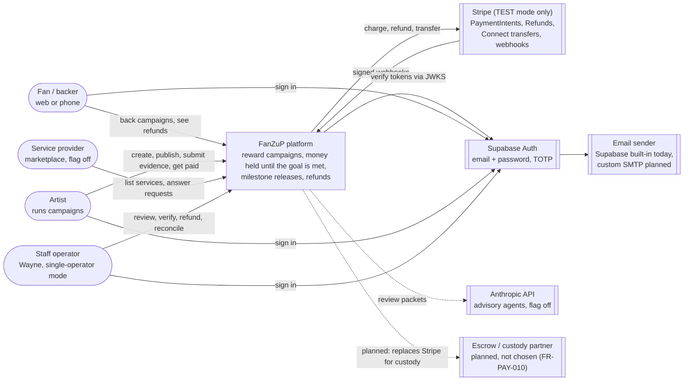
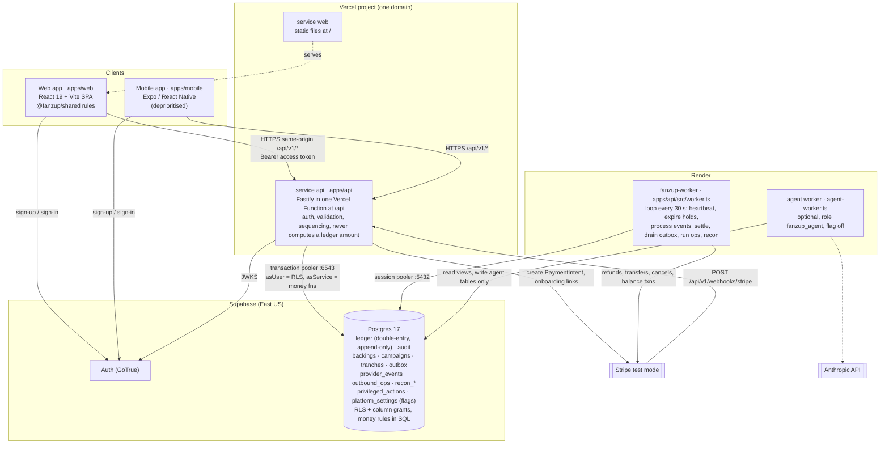
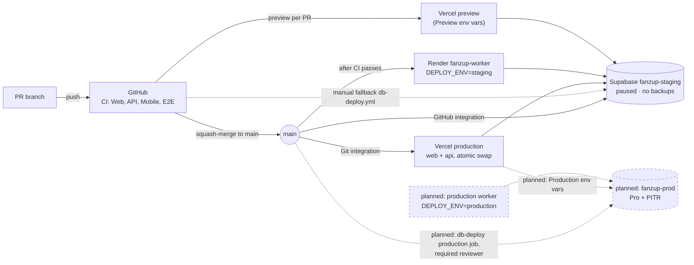
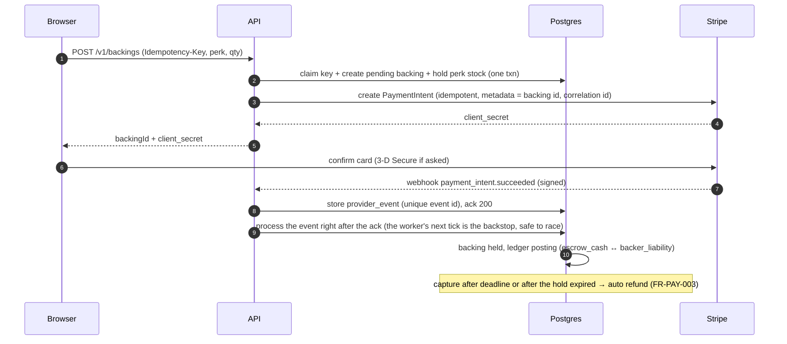
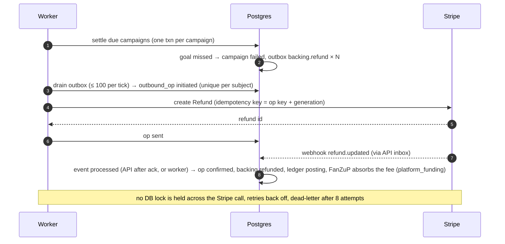
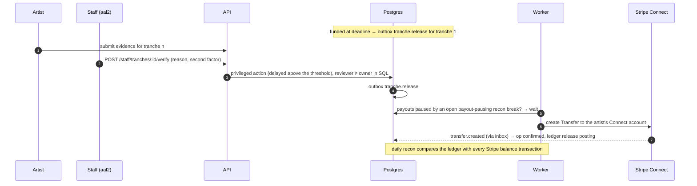

# Architecture diagrams · FanZuP
**Owner:** engineering · **Status:** active · **Date:** 2026-11-27 · **As built on:** `main` after PR #27 · **Sources:** `specs/02-design.md` §1, §5–§9, ADR-001…010, `vercel.json`, `render.yaml`, `supabase/config.toml`

C4-style views (context → containers → deployment), then the three money flows the FMEA analyses. Diagrams are Mermaid, so GitHub renders them and they're diffable. They show what runs today; planned pieces are drawn dashed and labelled *planned*. When a PR changes a box or an arrow here, it updates this file (`sdd-document`).

## 1. System context (C4 level 1)
Who uses FanZuP and which outside systems it depends on.

**Trust boundaries** (design §9): browser ↔ API (untrusted input, bearer tokens); API ↔ Postgres (money functions as `service_role` only); Stripe → webhook (signature on the raw body, livemode rejected); API/worker → Stripe (test key only); staff ↔ API (second factor, `aal2`).

## 2. Containers (C4 level 2)
What runs, what it owns, how the pieces talk.

**Who owns what** (design §1): the database owns every money rule and state transition; the API authenticates, authorises, validates and sequences provider calls; the worker owns everything time-based or retried; the provider adapter (`apps/api/src/provider/`) is the only code that talks to Stripe. The web and mobile apps are clients of the API for every money path and of Supabase Auth for identity only. Layer 2 (Reg CF) and its mock escrow service (`apps/mock-escrow`) exist only in local and CI; a deployed API refuses `REGCF_PROVIDER=mock`.

## 3. Deployment and release (today vs target)

Today every hosted piece points at the one staging database. NFR-OPS-01 needs the dashed production column before real users (readiness blocker B1). Deploy and rollback steps: `specs/runbooks/deploy-and-rollback.md`.

## 4. Backing (checkout) — claim-first, retry-safe (FR-PAY-001, FR-PAY-006)

## 5. Settlement and refunds — failed campaign (FR-PAY-003, FR-PAY-004)

## 6. Milestone release — funded campaign (FR-PAY-005)

## Change log
- 2026-11-27: first version (DOC audit condition 2; this PR).
